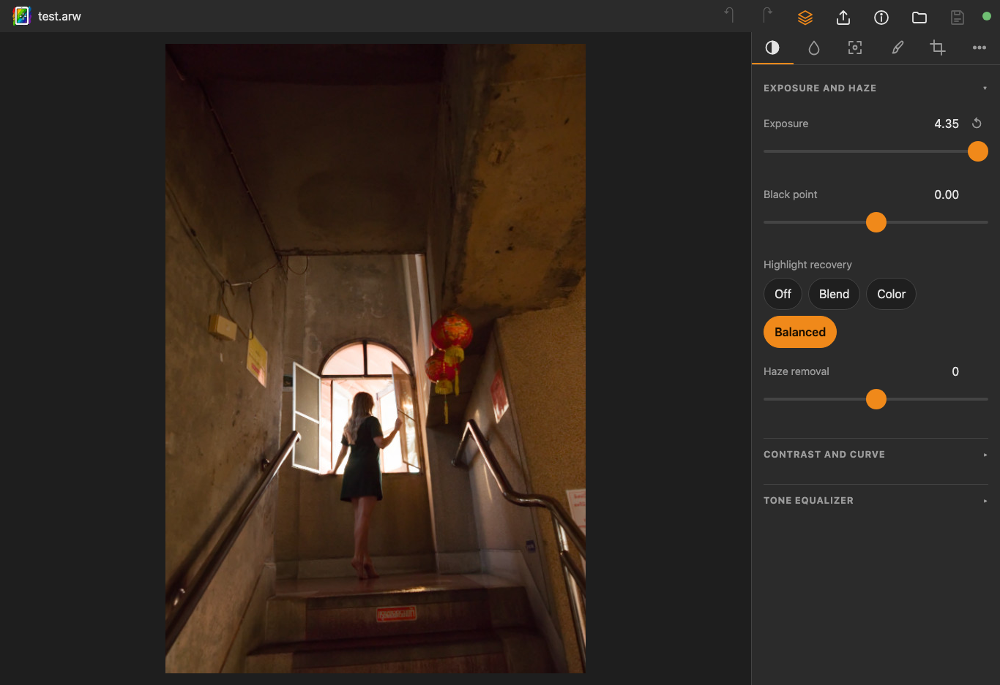
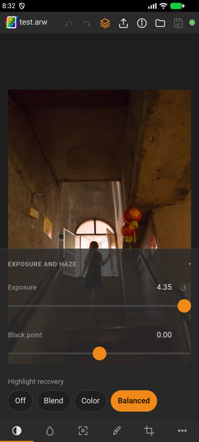

# MART (Mobile ART)

MART is a touch-first editor for one raw file at a time, built for tablets and phones. It runs the engine of
[ART](https://github.com/artraweditor/ART) through libART, so a picture is developed with the same pipeline as in the
desktop ART, and the edits are saved in the standard ART sidecar (`photo.arw.arp`). A shoot can be started on a tablet and
finished on the computer, or the other way round. MART runs as an app on Android and iOS, and also on a computer, from a
browser.

  
  

## Overview

MART offers a simplified interface with a selection of the tools of ART, organised so that the UI is touch-friendly. It has
undo and redo, profiles, and export to JPEG, PNG or TIFF at full size or resized. Whatever the sidecar has and MART has no
controls for is kept when you save.

There is no file browser, queue or batch processing. For the user documentation see the
[MART page](https://artraweditor.github.io/Mobile) of the ART website.

The source is organised like this:

    host/     the C++ host: serves the client and talks to libART (HTTP and WebSocket)
    client/   the web client, in TypeScript
    android/  the Android app: a WebView on the client, with the host and libART inside
    ios/      the iOS app, for iPhone and iPad: a WKWebView on the client, with the host and libART inside
    native/   the scripts that build the dependencies of libART for the mobile platforms

## Android and iOS

The apps are built by the GitHub Actions workflows in `.github/workflows/`, either by hand (Actions, then Android APK or
iOS IPA, then Run workflow) or when a release tag is pushed. In the second case the files are attached to the release:

  - `MART-android-arm64-VERSION.apk`, for 64-bit ARM devices with Android 8 or later;
  - `MART-ios-unsigned-VERSION.ipa`, for iPhones and iPads with iOS 16 or later. It is not signed (see below).

Both workflows build libART from [artraweditor/ART](https://github.com/artraweditor/ART). The input `art_ref` says which
branch, tag or commit to use. The dependencies of libART are cached between runs, until `native/` or the toolchain changes.
The first run takes an hour or more. The Android build runs on `ubuntu-24.04` and the iOS one on `macos-26`; the
repository variables `MART_ANDROID_RUNNER` and `MART_IOS_RUNNER` can select other images.

### Installing on Android

Copy the `.apk` to the device and open it, allowing the installation from that source when Android asks (or use
`adb install MART-android-arm64-VERSION.apk`). The first time, MART asks for the "All files access" permission: it needs it to list
the pictures of the device and to write the sidecars next to them.

The APK of the workflow is signed with your key if the repository has the secrets `ANDROID_KEYSTORE_BASE64`,
`ANDROID_KEYSTORE_PASSWORD`, `ANDROID_KEY_ALIAS` and, if the key has its own password, `ANDROID_KEY_PASSWORD`. Without
them it is signed with a key that is made for that run: it installs, but it cannot update an app that was installed from
another run.

### Installing on iOS

The `.ipa` has no signature, so that you can sign it with your own Apple ID. It has no entitlements and no extensions, which
is what the sideloading tools want. With a free Apple ID an app lasts 7 days and you can have 3 sideloaded apps at a time;
with a paid developer account it lasts a year. Before installing, turn on Developer Mode on the device (Settings, Privacy
& Security).

With [AltStore](https://altstore.io) (the classic version):

1. Install AltServer on a Mac or a PC, and AltStore on the device, as AltStore explains.
2. Put `MART-ios-unsigned-VERSION.ipa` on the device, for example in the Files app.
3. In AltStore open My Apps, tap `+` and choose the file (or open the file with AltStore from the Files app). AltStore signs
   it and installs it.
4. Keep AltServer running on the same network, so that AltStore can refresh the app before it expires.

With [Sideloadly](https://sideloadly.io): connect the device, drag the `.ipa` on the Sideloadly window, enter your Apple ID
and press Start.

To sign it yourself, you need a certificate and a provisioning profile of your developer account, and a tool that signs
`.ipa` files, like [zsign](https://github.com/zhlynn/zsign):

    zsign -k cert.p12 -p PASSWORD -m profile.mobileprovision -b com.example.MART -o MART-signed.ipa MART-ios-unsigned-VERSION.ipa

Then install `MART-signed.ipa` with Xcode (Window, Devices and Simulators, `+`), Apple Configurator or `ideviceinstaller`.
Use a bundle id that your provisioning profile allows: nothing in MART depends on it.

### Building the Android app

You need a JDK 21, the Android SDK (platform 37 and build-tools 37), the NDK r30 (30.0.16248370), `cmake`, `ninja`, `meson`,
`pkg-config`, `autoconf`, `automake`, `libtool`, `nasm`, Node.js and a checkout of ART (`ART_SRC`, by default `~/src/ART`),
recent enough to have the `thumbnail` command. On macOS or Linux:

    export ANDROID_NDK_HOME=/path/to/ndk/30.0.16248370
    export ANDROID_HOME=/path/to/sdk
    export JAVA_HOME=/path/to/jdk21
    export ART_SRC=~/src/ART

    native/fetch-sources.sh android
    native/build-deps.sh android arm64
    INSTALL_DATA=1 native/build-libart.sh android arm64
    android/build-native.sh release
    cd android && ./gradlew assembleRelease

The APK is in `android/app/build/outputs/apk/release/`. To sign it with your own key, set `MART_KEYSTORE`,
`MART_KEYSTORE_PASSWORD` and `MART_KEY_ALIAS` (see `android/app/build.gradle.kts`); `assembleDebug` makes a debug build.

### Building the iOS app

You need a Mac with Xcode, `xcodegen`, `cmake`, `ninja`, `meson`, `pkg-config`, `autoconf`, `automake`, `libtool`, `nasm`
and Node.js (all but Xcode are in Homebrew), and a checkout of ART as above.

    export ART_SRC=~/src/ART

    native/fetch-sources.sh ios
    native/build-deps.sh ios device
    INSTALL_DATA=1 ios/build-libart.sh device
    (cd client && npm ci)
    ios/build-ipa.sh MART-ios-unsigned.ipa

This makes the same unsigned `.ipa` as the workflow. For the Simulator use the `simulator` slice instead of `device`
(`native/build-deps.sh ios simulator`, `ios/build-libart.sh simulator`) and then `ios/build-app.sh simulator`.

To build an app signed with your own Apple developer team and put it on a device, set `MART_TEAM` to the team id
and run `ios/build-app.sh device -configuration Release -allowProvisioningUpdates`.

## Running in a browser

You need a build of ART that has libART (the shared library), `cmake`, `ninja`, a C++17 compiler and Node.js.

    cd host && cmake -S . -B build -G Ninja && cmake --build build
    cd ../client && npm install && npm run build
    cd ..

    ART=~/src/ART/build/gpu
    host/build/mart --www client/dist \
        --library $ART/src/libart/libART.dylib \
        --data $ART/Release/ART.app/Contents/Resources  /path/to/photo.arw

On Linux the library is `libART.so`. Then open http://localhost:8080.

Some options:

  - `--listen 0.0.0.0` makes MART reachable from a tablet on the network. The host then requires the token that it prints,
    so open the URL that it prints. `--require-token` asks for the token on the loopback address too, and `--port 0` picks a
    free port.
  - `--root DIR` (it can be repeated) sets the folders that the Open dialog can show. By default it is the folder of the image
    that was given. The dialog lists the subfolders and the thumbnails of the images in a folder, and it also accepts the
    path of a file or of a folder.
  - `--export-dir DIR` keeps the exports in DIR. Otherwise they go to `$TMPDIR` (or `/tmp`) and are downloaded by the
    browser.
  - `--profiles DIR` and `--luts DIR` change the folders of MART's own profiles and LUTs.
  - `--socket PATH` uses a running `ART-cli --server` instead of the engine in the same process.

MART is also a PWA, but browsers install web apps and run service workers only from a secure context: `http://localhost`,
or HTTPS. From a tablet on the network (`http://192.168.x.x:8080`) it works as a web page, but it cannot be installed unless
it is served over HTTPS, for example through a reverse proxy or a tunnel. The PNG icons are made from
`client/icons/MART-portrait.svg` by `client/make-icons.sh` (it needs `rsvg-convert`).

## Profiles and LUTs

MART has its own profiles (partial `.arp` files), in one folder: `~/.config/MART/profiles`, or `$XDG_CONFIG_HOME/MART/profiles`.
ART's own profiles are not offered. A profile can be applied, imported from a file, saved from the current settings (with one
checkbox for each section of the interface), renamed and deleted. One profile can be starred: it is applied to a picture that
has no sidecar, which otherwise starts from the neutral profile. White balance and crop are not checked when saving a profile,
since they belong to the picture.

The LUTs of the film simulation are MART's own too, in `~/.config/MART/luts` (or `$XDG_CONFIG_HOME/MART/luts`): Hald CLUT
images, CLF files and CTL scripts. A profile that uses one of them stores it as ART stores the LUTs of its own folder,
`file://R/<path in the folder>`, where the host name `R` means relative. The profile can then be applied in ART if the same LUT
is in its LUT folder, and when MART applies a profile it looks for such a LUT in its own folder. Renaming or deleting a LUT
breaks the profiles and sidecars that name it.

The retouching regions are regions of ART's Color/tone correction tool in perceptual mode, named `MART retouch <id>` and added
after the regions that the sidecar already has. In ART they are ordinary regions. The only mask is the brush, in "intersect"
mode, so a region with a brush mask and nothing painted does nothing. Halation is a region of the Smoothing tool in halation
mode, named `MART halation`.

## Tests

    cd host && ctest --test-dir build                  # patch serialiser, key allowlist, export requests
    cd client && npm test                              # patch helpers, crop geometry, export options (after npm run build)
    host/tests/run_e2e.sh /path/to/photo.arw           # live channel, export, profiles, geometry, Save, clean shutdown
    # browser tests (headless Chrome), with a host running on a COPY of an image (Save writes its sidecar):
    node host/tests/ui_smoke.mjs http://localhost:8080 /tmp           # sliders, undo
    node host/tests/ui_m3.mjs http://localhost:8080 /tmp /path/copy.arw   # crop drags, sheets, white balance, Save
    node host/tests/ui_m4.mjs http://localhost:8080 /tmp              # export sheet, busy state, download
    node host/tests/tools_e2e.mjs http://localhost:8080               # every tool's patch against the engine (changes the open image, not the sidecar)
    node host/tests/ui_tools.mjs http://localhost:8080 /tmp           # curve editor and the new tools (use a freshly started host)
    node host/tests/ui_extras.mjs http://localhost:8080 /tmp          # grain, halation, film simulation, Other tab (fresh host)
    node host/tests/ui_retouch.mjs http://localhost:8080 /tmp         # the Retouch tab: regions, sliders, painting (fresh host)
    node host/tests/ui_overflow.mjs http://localhost:8080 /tmp        # no sideways scrolling on phone widths
    node host/tests/ui_srgb.mjs http://localhost:8080 /tmp            # the preview stays sRGB whatever the profiles say (fresh host)
    node host/tests/srgb_e2e.mjs http://localhost:8080 /path/copy.arw   # exports are sRGB (a COPY: it rewrites its sidecar)
    node host/tests/profiles_e2e.mjs http://localhost:8080 /path/copy.arw DIR   # saving, applying, the default (host with --profiles DIR)
    node host/tests/ui_profiles.mjs http://localhost:8080 /tmp        # the Manage profiles sheet and the Save dialog (fresh host, own --profiles DIR)
    node host/tests/luts_e2e.mjs http://localhost:8080 LUTS_DIR PROFILES_DIR   # the LUT folder, and the R host in profiles (host with --luts and --profiles)
    node host/tests/ui_luts.mjs http://localhost:8080 /tmp            # the LUT drop-down and Manage LUTs (fresh host, own --luts DIR with sigmoid.ctl)
    node host/tests/ui_panel.mjs http://localhost:8080 /tmp           # the floating panel on a phone
    node host/tests/ui_resize.mjs http://localhost:8080 /tmp          # the picture stays fitted when the view changes
    MART_CMD='host/build/mart ... photo.arw' node host/tests/ui_reconnect.mjs    # server away and back
    MART_CMD='host/build/mart ... photo.arw' node host/tests/ui_pwa.mjs          # manifest, service worker, offline start

## License

MART is free software, released under the GNU General Public License, version 3 or (at your option) any later version; see
`LICENSE`. It includes [cpp-httplib](https://github.com/yhirose/cpp-httplib) and [nlohmann/json](https://github.com/nlohmann/json)
(in `host/third_party/`).
